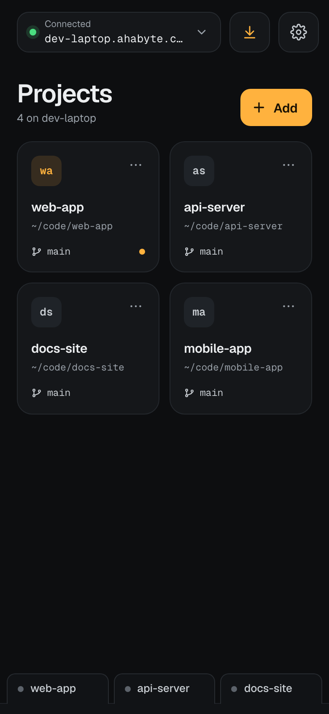
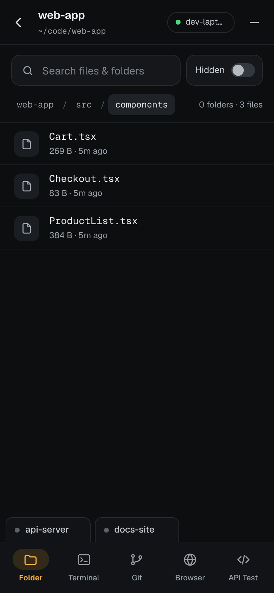
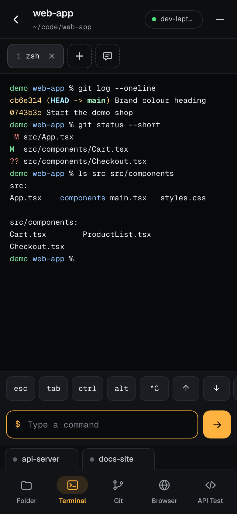
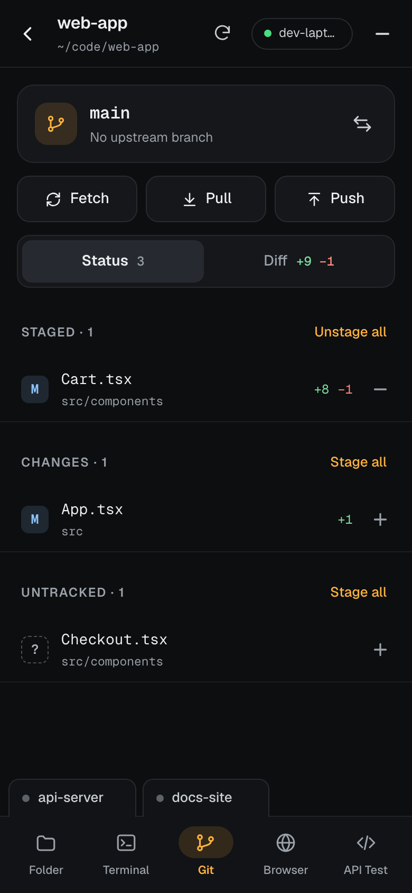
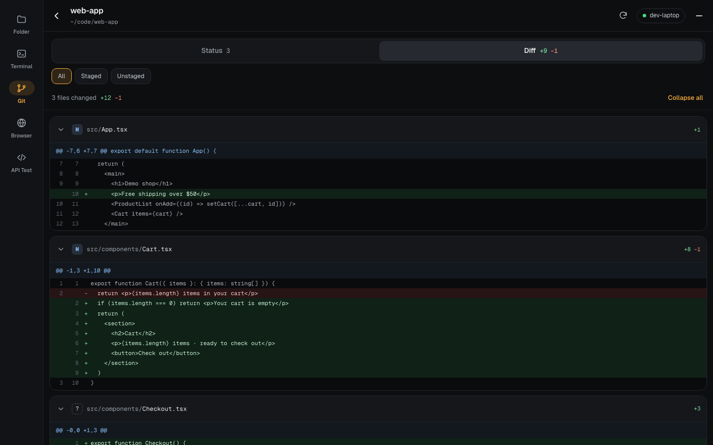
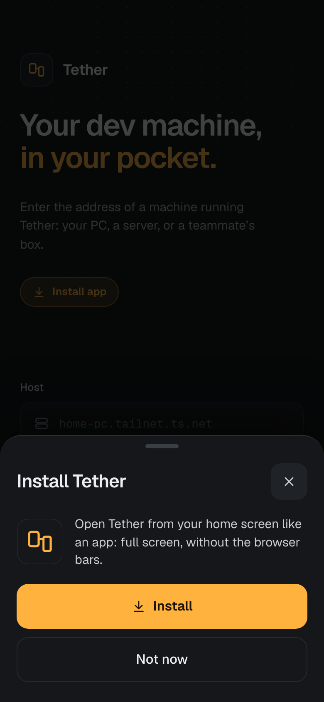
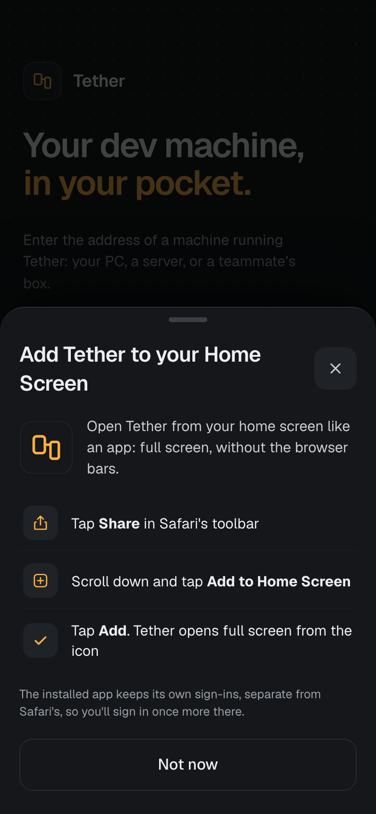

# Tether Homebrew tap

[Tether](https://tether.ahabyte.com) puts your dev machine in your pocket: browse files, run terminals, check git, preview dev servers and test APIs on your computer from your phone.

This tap installs it on macOS and Linux. On Windows, install it with [Chocolatey](#windows-chocolatey).

<p align="center">
  
  
  
  
</p>
<p align="center">
  
</p>

## Install

```sh
brew install Nirmitee-tech/tap/tether
tether start
```

On a new machine, `tether start` first asks how to run it:

- **Self-host** (the default, press Enter): everything stays on the machine, including its account. Tether opens a free Cloudflare tunnel and prints a link and a QR code; the link changes when Tether restarts. Open it on your phone and create the machine's account with the setup code it shows.
- **Tether host**: the machine joins your Tether account and gets a fixed address that never changes. The terminal shows a pairing link and a QR code; sign in to your Tether account (or create one) and approve the machine.

`tether start --self-host` or `tether start --hosted` skips the question. Either way Tether runs in the background: it restarts if it crashes and starts again at login.

**Install it like an app.** Open the link in your phone's browser and Tether offers to install itself: Chrome, Edge and Android get an **Install** button, iPhone and Safari get the steps.

<p align="center">
  
  
</p>

| Command | |
|---|---|
| `tether start [--self-host \| --hosted]` | start in the background and print the link |
| `tether status` | is it running and reachable? |
| `tether url` | print the link |
| `tether open` | open the Tether app for this machine |
| `tether setup-code` | the one-time code for a self-hosted machine's account |
| `tether logs -f` | follow the log |
| `tether stop` | stop it (and don't start at login) |

After `brew upgrade tether`, run `tether restart`.

Works on macOS (launchd) and Linux (systemd user service). On a Linux server, run `loginctl enable-linger $USER` so it keeps running when you're logged out.

## Windows (Chocolatey)

In an administrator PowerShell:

```powershell
choco install tether
```

Then, in a normal PowerShell (not as administrator, so your terminals aren't either):

```powershell
tether start
```

The first version on Chocolatey (0.8.0) is waiting for Chocolatey's moderators; `choco install tether` works once they approve it ([package page](https://community.chocolatey.org/packages/tether)).

It installs `cloudflared` too, and works on Windows 10 (version 1809 or later) and Windows 11, x64 or ARM64. `tether start` asks the same question as above, and the commands are the same. Terminals run PowerShell 7 if it's installed, otherwise Windows PowerShell; set `TETHER_SHELL` (for example to `cmd.exe` or Git Bash's `bash.exe`) before `tether start` to use another shell. In the background Tether runs as `tetherw.exe`, with no window, and starts again when you sign in (no administrator rights needed). After `choco upgrade tether`, run `tether start` again.

## Problems and ideas

Something broken, confusing or missing? [Open an issue](https://github.com/Nirmitee-tech/homebrew-tap/issues) with what you did, what happened, your OS, `tether version`, and the last lines of `tether logs` if it's about the server. Issues are public: leave out links, setup codes, passwords and anything from your own projects.

## Uninstall

On Tether host, first remove the machine from your Tether account (in the app: Settings → Remove … from your account), so its address is freed.

```sh
tether stop
brew uninstall tether
rm -rf ~/.tether     # this machine's account, projects, API collections and saved terminals
```

On Windows, in an administrator PowerShell (this stops Tether too):

```powershell
choco uninstall tether
Remove-Item -Recurse $HOME\.tether     # this machine's account, projects, API collections and saved terminals
```
